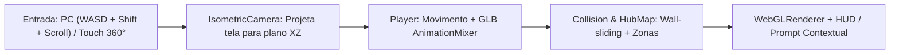

<div align="center">


<p>
  
  
</p>

**Action RPG isométrico 3D rodando direto no navegador — no PC e no celular.**  
Inspirado em *AnimA ARPG*, *Diablo* e na estética estilizada de *League of Legends*, com Home luminosa e protagonista 3D rigado no Blender.

[Por que usar](#-por-que-usar) •
[Fluxo e arquitetura](#-fluxo-e-arquitetura) •
[Funcionalidades](#-funcionalidades-e-comandos) •
[Estrutura](#-estrutura) •
[Instalação e uso](#-instalação-e-uso) •
[Validação e roadmap](#-validação-e-roadmap)

</div>

---

## 🎯 Por que usar

O **Game Alvorada (Santuário Cinzento)** entrega um protótipo jogável em WebGL sem dependências pesadas de engine externa, mantendo resposta ágil estilo MOBA/ARPG a 60 fps tanto no desktop quanto no smartphone.

- **Salão Real da Alvorada (Home luminosa):** rotunda circular com piso de cerâmica branca desenhada, luz solar diagonal através de janelões de vitral, portas monumentais (Portal das Masmorras, Forja e Loja Real) e Jardim Real externo com espelho d'água e pétalas ao vento.
- **Protagonista 3D real do Blender (`protagonist.glb`):** modelo estilizado com proporções heroicas, 15 texturas *hand-painted*, esqueleto humanoide de 22 ossos, 5 animações (`Idle`, `Walk`, `Run`, `AttackCombo`, `Dodge`) e sockets acoplados aos ossos reais (`Head`, `Spine2`, `RightHand`, `LeftHand`).
- **PC + Celular na mesma rede local:** o servidor de desenvolvimento gera QR Code automático no terminal e no HUD (`Jogar no Celular`) para abrir o jogo direto no smartphone com analógico virtual 360°, botão de correr multi-touch e modo tela cheia/PWA.

<div align="center">
  
</div>

---

## 🔄 Fluxo e arquitetura



---

## ⚡ Funcionalidades e comandos

| Item / Comando | Emoji | O que faz | Entrada / Saída |
|---|:---:|---|---|
| `npm run dev` | 🌐 | Sobe servidor Vite (`--host`) com QR Code mobile em `/__mobile-qr.json` | Abre em `http://localhost:5173/` (PC e Wi-Fi local) |
| `npm run build` | 🏗️ | Valida tipos (`tsc --noEmit`) e gera bundle otimizado em `dist/` | Código fonte `src/` + `public/` → `dist/` |
| `npm run preview` | 👀 | Serve localmente o build de produção para inspeção | Lê `dist/` gerado pelo build |
| `WASD` / `Shift` / `Scroll` | 🎮 | Movimentação em 8 direções alinhada à câmera, corrida e zoom | Controle responsivo com deslizamento suave (*wall-sliding*) |
| `Jogar no Celular` | 📱 | Exibe QR Code da rede local e ativa analógico 360° + correr multi-touch | Endpoint `GET /__mobile-qr.json` → SVG de QR Code |
| `public/models/protagonist.glb` | 🧍 | Modelo 3D estilizado criado no Blender 5.3.0 via MCP (`assets-src/protagonist.blend`) | Carregado por `GLTFLoader` + `AnimationMixer` com 5 clipes |

---

## 🗂️ Estrutura

<details open>
<summary><b>Árvore de diretórios do projeto</b></summary>

```text
game-alvorada/
├── .agents/                    # Fonte da verdade (config, docs técnicos 01..05, backlog e sessões)
├── assets/                     # Identidade visual do README (banner, logo e demo em SVG)
├── assets-src/
│   └── protagonist.blend       # Arquivo fonte editável do protagonista (Blender 5.3.0)
├── planejamentos-e-instrucoes/
│   └── BACKLOG.md              # Histórico das fases iniciais do protótipo
├── public/
│   ├── manifest.webmanifest    # Manifesto PWA para instalação/tela cheia no celular
│   └── models/
│       └── protagonist.glb     # Protagonista 3D rigado (22 ossos, 5 animações, 1,39 MB)
├── src/
│   ├── camera/
│   │   └── IsometricCamera.ts  # Câmera isométrica próxima, follow suave e projeção tela → XZ
│   ├── core/
│   │   ├── Game.ts             # WebGLRenderer, cena, loop principal e atualização do HUD
│   │   ├── Input.ts            # Teclado (WASD/Setas/Shift), Scroll e unificação com Touch
│   │   ├── MobileUi.ts         # Modal de QR Code, tela cheia e adaptações iOS/PWA
│   │   └── TouchControls.ts    # Analógico virtual 360° e botão correr multi-touch
│   ├── entities/
│   │   └── Player.ts           # GLTFLoader, AnimationMixer, sockets nos ossos e cinemática
│   ├── world/
│   │   ├── Collision.ts        # Colisão círculo-vs-círculo e círculo-vs-AABB (wall-sliding)
│   │   ├── HubMap.ts           # Salão Real da Alvorada, portas, partículas e Jardim Real
│   │   └── ProceduralTextures.ts # Texturas procedurais via Canvas (cerâmica e mármore)
│   ├── main.ts                 # Ponto de entrada (#game-canvas)
│   └── style.css               # Estilos do HUD, controles touch e modal QR Code
├── index.html
├── package.json
├── tsconfig.json
└── vite.config.ts              # Configuração Vite + plugin mobile-qr-plugin
```

</details>

---

## 🚀 Instalação e uso

<details open>
<summary><b>Pré-requisitos e configuração local</b></summary>

Requer **Node.js** (com `npm`) instalado.

```bash
# Instalar dependências (three, vite, typescript, qrcode)
npm install

# Iniciar servidor de desenvolvimento (PC + rede local para celular)
npm run dev
```

Depois de iniciar com `npm run dev`:
- **No PC:** acesse `http://localhost:5173/` (`WASD` para mover, `Shift` para correr, `Scroll` para zoom).
- **No Celular:** clique em **`Jogar no Celular`** no canto superior direito (ou escaneie o QR Code no terminal) estando no mesmo Wi-Fi.

</details>

<details>
<summary><b>Build de produção e pré-visualização</b></summary>

```bash
# Checar tipos TypeScript e gerar bundle de produção em dist/
npm run build

# Pré-visualizar o build gerado localmente
npm run preview
```

</details>

---

## 🛠️ Validação e roadmap

- **Checks automatizados:** `npm run build` (`tsc --noEmit && vite build`), registrado em [project.config.yml](.agents/project.config.yml). Ainda não há suíte de testes unitários ou linter configurados.
- **Documentação técnica e histórico:** [Arquitetura do Sistema](.agents/01_system_architecture.md), [Backlog de Execução](.agents/backlog.md) e [Histórico v0.1–v0.3](planejamentos-e-instrucoes/BACKLOG.md).
- **Próximos passos (Issues `#1` a `#5` em `.agents/backlog.md`):**
  1. **Narrativa e Lore (`#1`):** universo, papel da Home, motivação do protagonista e origem das masmorras.
  2. **Expansão da Home (`#2`):** NPCs (Ferreiro, Mercador) e Baú funcionais com interação contextual PC/mobile.
  3. **Equipamentos e Inventário (`#3`):** atributos, inventário e acoplamento visual de armas/armaduras nos sockets do `.glb`.
  4. **Combate ARPG (`#4`):** ataque básico, esquiva (`AttackCombo` / `Dodge`), dano e primeiros inimigos com IA.
  5. **Masmorras Randômicas e Loot (`#5`):** geração procedural pelo Portal das Masmorras, iluminação sombria contrastante e drops com raridades.
