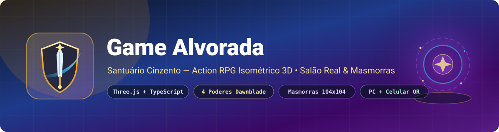
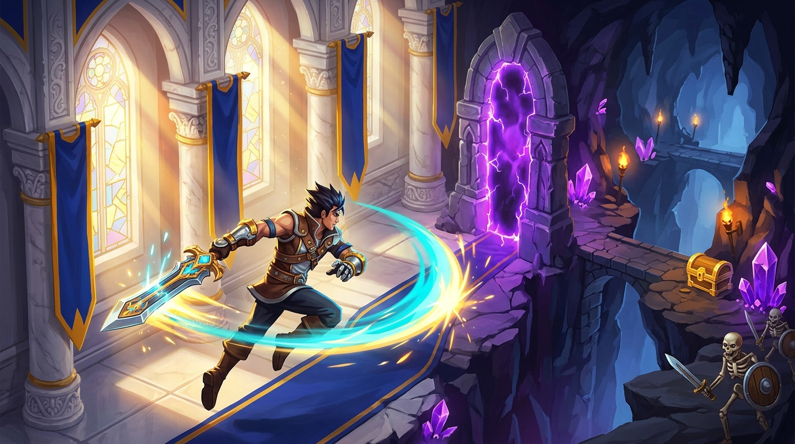
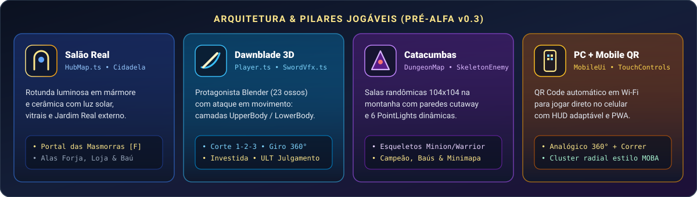
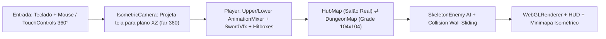

<div align="center">



<p>
  
  
  
  
</p>

**Action RPG isométrico 3D direto no navegador — do Salão Real luminoso às Masmorras Subterrâneas.**  
Inspirado em *AnimA ARPG*, *Diablo* e na estética estilizada de *League of Legends*, com protagonista rigado no Blender, poderes da espada *Dawnblade*, geração procedural de masmorras e inimigos esqueletos animados.

[Por que usar](#-por-que-usar) •
[Controles e poderes](#-controles-e-poderes-da-dawnblade) •
[Fluxo e arquitetura](#-fluxo-e-arquitetura) •
[Funcionalidades](#-funcionalidades-e-comandos) •
[Estrutura](#-estrutura) •
[Instalação e uso](#-instalação-e-uso) •
[Validação e roadmap](#-validação-e-roadmap)

</div>

---

## 🎯 Por que usar

O **Game Alvorada (Santuário Cinzento)** entrega um protótipo ARPG 3D jogável em WebGL sem dependências pesadas de engine externa, mantendo resposta ágil a 60 fps tanto no desktop quanto no smartphone.

<div align="center">
  
</div>

<br />

- **Salão Real da Alvorada (Home luminosa):** rotunda circular em mármore e cerâmica desenhada, raios solares através de janelões de vitral, Jardim Real externo com espelho d'água e Grande Portal Norte acionável (`F` / `Enter` ou toque) para entrar nas expedições.
- **Protagonista 3D & Combate em Movimento (`protagonist.glb`):** modelo estilizado criado no Blender 5.3.0 (23 ossos, 10 clipes, arma `Weapon_Dawnblade` em `Weapon_R` e 5 sockets reais), com mistura esquelética `UpperBody` / `LowerBody` no `AnimationMixer` para desferir combos de espada correndo sem *foot-sliding*, além de VFX 3D (`SwordVfx.ts`).
- **Masmorras Procedurais dentro da Montanha (`DungeonMap.ts`):** grade `104x104` com 6 a 8 salas amplas (`19.2m` a `26.4m`) e corredores de `7.2m`, paredes *cutaway* que nunca tampam o herói, fundações descendo até o leito da caverna, anfiteatro de montanhas subterrâneas, iluminação dinâmica de 6 `PointLight`s de fogo, minimapa isométrico, baús dourados e hordas de Esqueletos animados (`Minion`, `Rogue`, `Warrior` e `Champion`).
- **PC + Celular instantâneo na mesma rede Wi-Fi:** o dev server (`vite --host`) expõe QR Code automático no terminal e no HUD (`Jogar no Celular`) abrindo o jogo no smartphone com analógico virtual 360°, cluster radial de poderes estilo MOBA, corrida multi-touch e PWA em tela cheia.

<div align="center">
  
</div>

<br />

<div align="center">
  
</div>

---

## 🎮 Controles e poderes da Dawnblade

| Ação | Teclado (PC) | Celular (Touch) | Comportamento em jogo |
|---|---|---|---|
| **Mover** | `W` `A` `S` `D` / Setas | Analógico 360° (esquerda) | Movimento livre alinhado à projeção isométrica com *wall-sliding* |
| **Correr** | `Shift` | Botão `CORRER` | Aumenta velocidade e alterna suavemente para o clipe `Run` |
| **Interagir / Portal** | `F` / `Enter` | Botão contextual no topo | Entra na masmorra pelo Portal Norte, desce andares na Fenda ou volta ao Salão |
| **Corte da Alvorada** | `1` / `J` (ou clique) | Botão principal `CORTE` | Combo de 3 golpes (`UpperBody` livre durante corrida) com rastro crescente |
| **Giro Ciclone 360°** | `2` / `Q` / `K` | Botão `GIRO` | Ataque giratório em área (3 pulsos 360°, cooldown `3.5s`) |
| **Investida Real** | `3` / `E` / `L` | Botão `DASH` | Avanço perfurante direcional com cone sônico (cooldown `4.5s`) |
| **ULT: Julgamento** | `4` / `R` / `Espaço` | Botão dourado `ULT` | Salto heroico com impacto em área, onda de choque e pilar solar (cooldown `9.0s`) |
| **Zoom da Câmera** | `Scroll` do mouse | — | Ajusta aproximação isométrica (`[0.72, 1.45]`) |

---

## 🔄 Fluxo e arquitetura



---

## ⚡ Funcionalidades e comandos

| Item / Comando | Emoji | O que faz | Entrada / Saída |
|---|:---:|---|---|
| `npm run dev` | 🌐 | Sobe servidor Vite (`--host`) com QR Code mobile em `/__mobile-qr.json` | Abre em `http://localhost:5173/` (PC e Wi-Fi local) |
| `npm run build` | 🏗️ | Valida tipos (`tsc --noEmit`) e gera bundle otimizado em `dist/` | `src/` + `public/` → `dist/` |
| `npm run preview` | 👀 | Serve localmente o build de produção gerado em `dist/` | Lê bundle estático de `dist/` |
| `DungeonMap.ts` | 🏔️ | Gera masmorras aleatórias com fundações, montanhas, tochas e Fenda Abissal | Semente única `mulberry32` → salas, colisores e minimapa |
| `SkeletonEnemy.ts` | 💀 | Instancia `minion`, `rogue`, `warrior` e `champion` com armas, barra HP e IA | `SkeletonUtils.clone` + `PlayerAttackHitbox` → dano/morte |
| `public/models/` | 🗿 | Protagonista Blender (`protagonist.glb`) + 39 modelos CC0 1.0 organizados por domínio | `GLTFLoader` + `DungeonAssetLibrary` / `SkeletonAssetLibrary` |

---

## 🗂️ Estrutura

<details open>
<summary><b>Árvore de diretórios do projeto</b></summary>

```text
game-alvorada/
├── .agents/                          # Fonte da verdade (config, docs técnicos 01..05, catálogo CC0 e backlog)
├── assets/                           # Identidade visual do README (banner, logo, demo, showcase e showcase-art)
├── assets-src/
│   └── protagonist.blend             # Arquivo fonte editável do protagonista (Blender 5.3.0)
├── planejamentos-e-instrucoes/
│   └── BACKLOG.md                    # Histórico das fases iniciais do protótipo
├── public/
│   ├── manifest.webmanifest          # Manifesto PWA para instalação e tela cheia no celular
│   └── models/
│       ├── protagonist.glb           # Protagonista rigado (23 ossos, 10 animações, Dawnblade em Weapon_R)
│       ├── characters/               # 6 modelos CC0 (npc_knight, rat, spider e esqueletos minion/rogue/warrior)
│       ├── dungeon/                  # 16 modelos CC0 de arquitetura, props e montanhas (KayKit + Quaternius)
│       └── items/                    # 17 modelos CC0 de equipamentos, baús, poções, moedas e armas de esqueletos
├── src/
│   ├── camera/
│   │   └── IsometricCamera.ts        # Câmera isométrica próxima, follow suave, far 360 e projeção tela → XZ
│   ├── core/
│   │   ├── Game.ts                   # WebGLRenderer, transição Home ⇄ Masmorra, combate, loop e HUD
│   │   ├── Input.ts                  # Teclado (WASD/Shift/F/Enter/1-4/QER), Scroll e ações touch
│   │   ├── MobileUi.ts               # Modal de QR Code Wi-Fi, tela cheia e suporte iOS/PWA
│   │   └── TouchControls.ts          # Analógico virtual 360° e cluster radial MOBA multi-touch
│   ├── entities/
│   │   ├── Player.ts                 # GLTFLoader, split Upper/Lower Body, sockets, combos e hitboxes
│   │   ├── SkeletonEnemy.ts          # Inimigos esqueletos animados, armas em handslot, IA e barra de vida 3D
│   │   └── SwordVfx.ts               # Efeitos 3D de rastro crescente, Giro 360°, Investida e Ultimate
│   ├── world/
│   │   ├── Collision.ts              # Wall-sliding (círculo/AABB) e seleção de zonas de interação
│   │   ├── DungeonAssets.ts          # Cache compartilhado e normalização de props CC0 das masmorras
│   │   ├── DungeonMap.ts             # Gerador procedural 104x104, montanha cavernosa, 6 luzes e minimapa
│   │   ├── HubMap.ts                 # Salão Real da Alvorada, portais, poeira dourada e Jardim Real
│   │   └── ProceduralTextures.ts     # Texturas Canvas (cerâmica, mármore, ardósia, rocha e feixes de luz)
│   ├── main.ts                       # Ponto de entrada (#game-canvas)
│   └── style.css                     # HUD, barras de cooldown radial (--cd-deg), minimapa e controles touch
├── index.html                        # Estrutura DOM do HUD, gradientes SVG dos botões e controles touch
├── package.json
├── tsconfig.json
└── vite.config.ts                    # Configuração Vite + plugin mobile-qr-plugin (/__mobile-qr.json)
```

</details>

---

## 🚀 Instalação e uso

<details open>
<summary><b>Pré-requisitos e execução local</b></summary>

Requer **Node.js** (com `npm`) instalado.

```bash
# Instalar dependências (three, vite, typescript, qrcode)
npm install

# Iniciar servidor de desenvolvimento (PC + rede local para celular)
npm run dev
```

Depois de iniciar com `npm run dev`:
- **No PC:** acesse `http://localhost:5173/`, aproxime-se do **Portal Norte** no Salão Real e pressione `F` (ou clique no botão) para entrar nas *Catacumbas Cinzentas*.
- **No Celular:** clique em **`Jogar no Celular`** no canto superior direito (ou escaneie o QR Code no terminal) estando no mesmo Wi-Fi.

</details>

<details>
<summary><b>Build de produção e pré-visualização</b></summary>

```bash
# Checar tipos TypeScript e gerar bundle de produção em dist/
npm run build

# Pré-visualizar o build gerado localmente
npm run preview
```

</details>

---

## 🛠️ Validação e roadmap

- **Checks automatizados:** `npm run build` (`tsc --noEmit && vite build`), configurado em [project.config.yml](.agents/project.config.yml). Ainda não há suíte de testes unitários nem linter configurados.
- **Documentação e catálogo:** [Arquitetura do Sistema](.agents/01_system_architecture.md), [Catálogo de Assets CC0](.agents/cc0_assets_catalog.md), [Backlog de Execução](.agents/backlog.md) e [Histórico Inicial](planejamentos-e-instrucoes/BACKLOG.md).
- **Próximos passos planejados (`#1` a `#5` em `.agents/backlog.md`):**
  1. **Narrativa e Lore (`#1`):** universo, papel da Home, motivação do protagonista e origem das masmorras.
  2. **Expansão da Home (`#2`):** NPCs (Ferreiro, Mercador) e Baú Real interativos para compra, venda e armazenamento.
  3. **Equipamentos e Inventário (`#3`):** atributos do herói e acoplamento visual dos equipamentos nos sockets reais (`head`, `chest`, `back`, `rightHand`, `leftHand`).
  4. **Progressão de Combate e Loot (`#4`–`#5`):** ataque dos inimigos causando dano real ao jogador, coleta de moedas/poções/itens dropados por esqueletos e baús, e retorno à Home mantendo o inventário.
